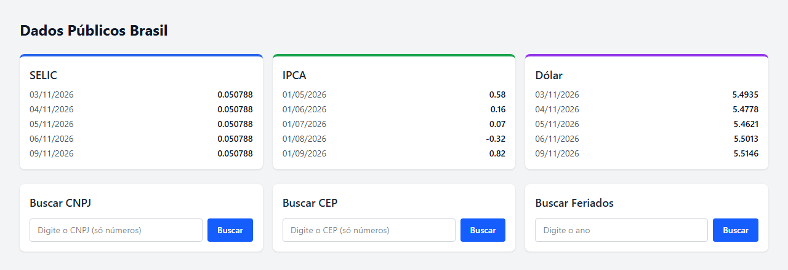

# Dados Públicos Brasil

Painel que reúne **indicadores econômicos** (SELIC, IPCA e Dólar) e **consultas de CNPJ, CEP e feriados nacionais** em um só lugar. O sistema consome APIs públicas do **Banco Central** e da **BrasilAPI**, e a API própria guarda as respostas em **cache no PostgreSQL** para responder mais rápido e diminuir as chamadas externas.

🔗 **Demo:** https://dados-publico-brasil.vercel.app
📄 **Documentação da API (Swagger):** https://dados-publico-brasil.onrender.com/docs

> A API está no plano gratuito do Render, que "dorme" sem uso. Por isso, a primeira requisição pode levar até ~1 minuto.



## Funcionalidades

- **Indicadores econômicos:** últimos valores da SELIC, do IPCA e do Dólar (séries do Banco Central)
- **Consulta de CNPJ:** razão social, nome fantasia, situação cadastral, município/UF e atividade principal
- **Consulta de CEP:** endereço completo e códigos IBGE
- **Feriados nacionais** de qualquer ano
- **Cache com expiração (TTL):** 1 hora para indicadores e 7 dias para CNPJ, CEP e feriados
- **Validação de entrada:** CNPJ com 14 dígitos e CEP com 8; erros das APIs externas viram respostas `502` claras

## Arquitetura

```
React (Vercel)  ──►  FastAPI (Render)  ──►  Cache no PostgreSQL ──(se expirado)──►  Banco Central / BrasilAPI
```

1. O frontend chama a API própria.
2. A API procura a resposta no cache (tabela `cache_entries`).
3. Se não existir ou estiver expirada, consulta a API pública, salva no cache com upsert (`ON CONFLICT DO UPDATE`) e devolve.

## Tecnologias

| Camada | Tecnologias |
|---|---|
| Backend | Python, FastAPI, SQLAlchemy 2 (async), asyncpg, httpx, Pydantic |
| Banco de dados | PostgreSQL |
| Frontend | React 19, TypeScript, Vite, Tailwind CSS |
| Testes | pytest, pytest-asyncio, respx (mock de HTTP) |
| Deploy | Render (API) e Vercel (frontend) |

## Endpoints

| Método | Rota | Descrição |
|---|---|---|
| GET | `/selic?ultimos_n=5` | Últimos valores da SELIC |
| GET | `/ipca?ultimos_n=5` | Últimos valores do IPCA |
| GET | `/dolar?ultimos_n=5` | Últimas cotações do Dólar |
| GET | `/cnpj/{cnpj}` | Dados da empresa (14 dígitos, só números) |
| GET | `/cep/{cep}` | Endereço do CEP (8 dígitos) |
| GET | `/feriados/{ano}` | Feriados nacionais do ano |

## Como rodar localmente

**Pré-requisitos:** Python 3.10+, Node.js 20+ e PostgreSQL.

### Backend

```bash
python -m venv .venv
source .venv/bin/activate        # no Windows: .venv\Scripts\activate
pip install -r requirements.txt

cp .env.example .env             # depois ajuste a DATABASE_URL
uvicorn main:app --reload
```

A API sobe em `http://localhost:8000`, com a documentação em `http://localhost:8000/docs`. A tabela de cache é criada automaticamente na inicialização.

### Frontend

```bash
cd frontend
npm install
cp .env.example .env             # VITE_API_URL=http://localhost:8000
npm run dev
```

O frontend sobe em `http://localhost:5173`.

## Testes

```bash
pytest
```

- **`test_cache_repository.py`:** testa o cache contra um PostgreSQL de teste (salvar e buscar, chave inexistente, chave expirada e atualização de chave duplicada).
- **`tests/`:** testa os serviços do Banco Central e da BrasilAPI com **respx**, que simula as respostas HTTP. Assim os testes não dependem da internet e cobrem os cenários de sucesso e de falha.

> Os testes do cache usam o banco `dados_brasil_test` (veja `conftest.py`).

## Próximos passos

- [ ] Docker Compose (API + PostgreSQL) para subir tudo com um comando
- [ ] GitHub Actions rodando os testes a cada push
- [ ] Testes dos endpoints com o `TestClient` do FastAPI

---

Desenvolvido por **Anderson Galvão** · [LinkedIn](https://www.linkedin.com/in/aqgalvaojr/)
